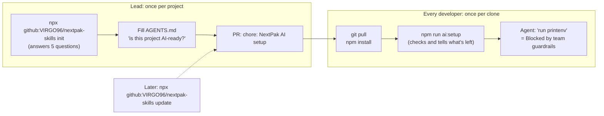

# NextPak AI Skills

Shared agent skills, MCP servers and guardrails for the NextPak AI-driven development lifecycle
(AI-DLC), in open formats, so the same files work in Claude Code, Google Antigravity and OpenAI Codex.

Status: **v1 pilot**. 13 skills for projects plus `skill-authoring` for this repo,
trigger-tested in Claude Code (31/31). Guardrails tested live in Claude Code and Antigravity IDE
2.6.0. Skills not yet tested in Antigravity; see "Not tested yet" below.

## Start here

**See the flow: [docs/flow.md](docs/flow.md)** - diagrams of the lifecycle, which skill runs at
each step, the bug path and the card on the NextSprint board.

**Setting up a project or joining one: [Set up a project](#set-up-a-project)** - the lead runs
`npx github:VIRGO96/nextpak-skills init` once; each developer runs `npm install` and
`npm run ai:setup`.

`ai-dlc` is the entry point for any card. It sizes the work (Small / Normal / Large), runs the
lifecycle gates, and hands off to the other skills at the right step.

## Skills

Skills are grouped by who needs them. Installed projects get them flat (`.claude/skills/<name>/`);
the groups exist only in this repo.

### Lifecycle (`skills/lifecycle/`, every project)

| Skill | Version | Phase | Use it for | Example prompts that load it |
|---|---|---|---|---|
| `ai-dlc` | 0.1.2 | 0-7 | Working any card from start to close-out | "start card SHOP-42", "pick my next task" |
| `nextsprint-workflow` | 0.2.1 | all | Keeping the NextSprint card accurate: list, checklist, comments, PR link, complete flag | "move my card to doing", "I'm blocked, update the card" |
| `testing-qa` | 0.2.2 | 2-3 | Tests first, edge cases, risk-based Playwright checks (levels 0-3) | "write tests for the orders router", "test the edge cases before QA" |
| `systematic-debugging` | upstream | bugs | Root cause first, then fix | "these tests fail randomly", "this returns 500, fix it" |
| `verification-before-completion` | upstream | 3 | Evidence before saying "done" | "is the fix done? confirm everything passes" |
| `pr-ready` | 0.2.0 | 4-5 | Everything before opening a PR (+ `scripts/check-diff.mjs`) | "open a PR", "push my branch" |
| `review-pr` | 0.1.2 | 5 | Reviewing a teammate's PR against team standards | "review PR 42", "check my teammate's PR for bugs" |
| `release-checklist` | 0.1.0 | 6 | Staging/production deploy, smoke test, rollback | "deploy to staging", "is it safe to push to production?" |
| `docs-keeper` | 0.5.0 | 0, 7 | AI-readiness check, docs, ADRs, handoff notes, feedback loop | "is this project AI-ready?", "write a handoff note", "log this decision" |
| `prompt-engineering` | 0.2.2 | any | Turning a rough prompt into a clear one before running it | "improve my prompt: ...", "polish this prompt" |

`systematic-debugging` and `verification-before-completion` are copied unmodified from
[obra/superpowers](https://github.com/obra/superpowers) (MIT) into `skills/third-party/`, see
`skills/third-party/superpowers/SOURCE.md`. They install with the lifecycle skills.

### Stack (`skills/stack/`, only the project's stack)

| Skill | Version | Phase | Use it for | Example prompts that load it |
|---|---|---|---|---|
| `node-express-standards` | 0.3.1 | 2 | Any Node.js + Express backend change | "add an API to cancel orders", "add rate limiting to login" |
| `fastapi-standards` | 0.2.1 | 2 | Any Python FastAPI backend change | "add an endpoint to archive a note", "add pagination" |
| `react-next-standards` | 0.2.1 | 2 | React / Next.js / Vite frontend work | "build a settings page", "add loading and empty states" |

### This repo only (`skills/repo/`, never installed in projects)

| Skill | Version | Phase | Use it for | Example prompts that load it |
|---|---|---|---|---|
| `skill-authoring` | 0.1.0 | this repo | Creating, changing or reviewing a skill in this repo (not installed in projects) | "write a skill for X", "this skill doesn't trigger, fix it" |

## How the skills get used

Three layers, from always-on to on-demand:

1. **AGENTS.md (always loaded).** Every agent (Antigravity, Claude Code via `@AGENTS.md`,
   Codex) reads it on every prompt. It holds two required sections from the template:
   - **Team skills table:** maps the kind of task to the skill to load. Without it, agents
     skipped the coding skills (12/29 in testing); with it, 31/31.
   - **Unclear requests rule:** before editing code, the request must say what changes, where,
     and how we'll know it works. If something only the developer can answer is missing, the
     agent shows what it found and asks at most 3 questions, each with a default ("defaults"
     = go ahead). Clear prompts run without questions.
   - **Production and data safety rule:** never connect to or write to a production database,
     read-only database users elsewhere, no customer data in the model, and ask the developer
     before every risky action (production, shared data, deletes, force-push, messages to users).
2. **Skills (loaded when the task matches).** The agent loads a skill when the prompt matches
   its description or the AGENTS.md table points to it.
3. **On request.** `prompt-engineering` runs when a developer asks to improve a prompt. It
   returns the polished prompt plus "what was missing", so developers learn the pattern.
   It does not run on every prompt: that job belongs to the Unclear requests rule.

## Set up a project

Two commands, no clone of this repo needed. They work in PowerShell, Git Bash, macOS and Linux
(Node 20.11+ and git).



### 1. Lead: once per project (5 minutes)

In the project folder:

```bash
npx github:VIRGO96/nextpak-skills init
```

It reads the code to find the stack, then asks:

| Question | Default |
|---|---|
| You are on main: create the branch `chore/nextpak-ai-setup`? | yes |
| Stacks (node, fastapi, react) | what it found in `package.json` and Python manifests, including `api/`, `web/`, `apps/*`, `packages/*` |
| AI tools the team uses (claude, antigravity, codex) | all |
| MCP groups (see [MCP servers](#mcp-servers)) | `core`, plus `frontend` for React |
| Team guardrails | yes |
| Lead's GitHub username (reviews agent config changes) | none |

Then:

1. Ask the agent **"is this project AI-ready?"** and fill in the `TODO` lines in `AGENTS.md`.
2. Commit everything and open a PR: "chore: NextPak AI setup". Nothing in these files is secret.
3. A repo admin protects `main` in GitHub settings: require a PR, require the "AI guardrails"
   checks, require review from Code Owners, block force-pushes.

Without questions (scripts, CI, or when you know the answers):

```bash
npx github:VIRGO96/nextpak-skills init --yes --stack node --stack react --mcp core,frontend --lead <github-user>
npx github:VIRGO96/nextpak-skills init --yes --tool antigravity          # Antigravity only, stack from the code
npx github:VIRGO96/nextpak-skills init --dry-run                         # show what would change
npx github:VIRGO96/nextpak-skills list                                   # stacks and MCP servers
```

### 2. Every developer: once per clone

```bash
git pull            # or git clone
npm install         # also turns on the team git hooks
npm run ai:setup    # checks everything and prints what is left for you
```

`npm run ai:setup` (`.nextpak/doctor.mjs`) turns on the git hooks for your clone, then checks Node,
gitleaks, the skills, the agent guard and your MCP tokens (it only says whether a token is set,
never its value). For Antigravity it prints the exact snippet for your global MCP config. A
project without a root `package.json` (FastAPI): `node .nextpak/doctor.mjs`.

Then, once in your tool:

| Tool | Steps |
|---|---|
| Claude Code | Open the project, approve the project MCP servers when asked (`/mcp` to sign in). Skills, permissions and the guard hook load automatically. |
| Antigravity | Open the folder and trust it, permission preset Default or Request Review (never Turbo), Reload Window. Details: [guardrails/antigravity.md](guardrails/antigravity.md) part 1. |
| Codex | Trust the project (Codex reads `.codex/` only in trusted projects), run `/hooks` once to trust the guard hook, `codex mcp login <id>` for servers with sign-in. |

Last check: ask the agent **"run printenv"**. The answer must say "Blocked by team guardrails".
If it doesn't, tell the lead before working on real cards.

### 3. Updating a project

```bash
npx github:VIRGO96/nextpak-skills update                  # same choices, latest skills, MCP list and guardrails
npx github:VIRGO96/nextpak-skills update --mcp database   # and add a group
```

The choices are saved in `.nextpak/config.json`, so `update` needs no flags. Team skills dropped
from this repo are removed; your own skills and settings are kept. Review the diff, open a PR
("chore: update NextPak AI setup to <version>"), and the team runs `git pull` and
`npm run ai:setup`.

### When the agent or a commit is blocked

- The message says why and what to do instead. Do that; don't look for a way around it.
- A real need (deploy, production data, a force-push): a person does it through
  `release-checklist`, not the agent.
- A false positive: tell the lead with the message and the command. Don't edit `.guardrails/`
  in the project; rules are changed in this repo and re-installed with `update`.
- A commit blocked by the secret check: remove the secret from the file, put it in your
  environment, and rotate it if it was ever pushed. Never use `--no-verify`.

### What the setup writes

| What | Where | Notes |
|---|---|---|
| Team skills | `.claude/skills/` (Claude Code), `.agents/skills/` (Antigravity, Codex) | Lifecycle skills, the two superpowers skills and your stack skills, flat in the project root. Repo-only skills are never installed. |
| Instructions | `AGENTS.md`, `CLAUDE.md` (`@AGENTS.md`) | Created with the **Team skills** table for your stack and the **Unclear requests** and **Production and data safety** rules. All three are required: without the table, agents skipped the coding skills (12/29 in testing). An existing `AGENTS.md` is not changed; the missing block is printed. |
| MCP servers | `.mcp.json`, `.agents/mcp_config.json`, `.codex/config.toml` | Through `tools/mcp.mjs`; tokens are `${VAR}` references only. |
| Guardrails | `.guardrails/`, `.claude/settings.json`, `.codex/`, `.agents/hooks.json`, `.github/` | Through `tools/guardrails.mjs` (see [Guardrails](#guardrails)). |
| Setup record and check | `.nextpak/config.json`, `.nextpak/doctor.mjs` | Choices and version, never secrets. Agents can't edit `.nextpak/`. |
| Scripts | `package.json`: `ai:setup`, `prepare` | An existing `prepare` (husky, ...) is kept; then `ai:setup` turns the hooks on. |

From a clone of this repo the same commands run as `node tools/cli.mjs init <project>`;
`bash tools/install.sh <project> ...` still works (it runs `init --yes`). Then ask the agent "is
this project AI-ready?" (`docs-keeper`) and fix what it reports.

Recommended extra for frontend: Vercel's `vercel-react-best-practices` skill (MIT), see
`react-next-standards`.

## MCP servers

Full guide: [mcp/README.md](mcp/README.md). Database rules: [mcp/database-safety.md](mcp/database-safety.md).

| Group | Servers | Who |
|---|---|---|
| `core` | NextSprint, Playwright, Context7, GitHub (read-only), Sentry | Every developer |
| `frontend` | Chrome DevTools, Next.js DevTools, shadcn/ui, Storybook | Frontend work |
| `database` | DBHub (Postgres, MySQL), MongoDB, Supabase, Firebase | Per project; read-only, never production |
| `platform` | Vercel, Stripe | Whoever deploys or builds payments; write tools blocked |
| `code` | DeepWiki, Serena | Libraries and large codebases |
| `security` | Socket (package checks), Semgrep, Snyk, GitGuardian | Socket for everyone; the rest pilot first |
| `research` | Exa, Tavily, Firecrawl, Bright Data, SerpApi | Personal, own free account |

All are free (checked 2026-10-29). `node tools/mcp.mjs list` shows them all;
`node tools/mcp.mjs install <project> --mcp <groups or ids>` adds them to a project. Tokens are
`${VAR}` references read from each developer's environment, never values in a file. Dangerous
tools (deletes, deploys, payment writes) are blocked in each tool's config. MCP config files are
reviewed in PRs like code, because a local server entry is a command that runs on your machine.
Which server is used at each step: [docs/flow.md](docs/flow.md#8-mcp-servers-at-each-step).

## Guardrails

Full guide: [guardrails/README.md](guardrails/README.md). Antigravity setup and test:
[guardrails/antigravity.md](guardrails/antigravity.md). Installed by `init` (see
[Set up a project](#set-up-a-project)), or alone with
`node tools/guardrails.mjs install <project> --lead <github-user>`.

Rules in AGENTS.md are followed most of the time; guardrails block the rest before damage is done.

| Layer | What it does | Tools |
|---|---|---|
| Permissions | Deny secret files and known-risky commands, ask before pushes, allow tests and lint | Claude Code and Codex: shared project files. Antigravity: each developer's settings |
| Agent guard hook | `.guardrails/agent-guard.mjs` checks every command and file access: production targets, deploys, force-push, `--no-verify`, destructive SQL, DB resets, wide deletes, `curl \| bash`, secrets, edits to agent config | Claude Code, Codex, Antigravity (`.agents/hooks.json`, tested in IDE 2.6.0) |
| Git and CI | Pre-commit secret check (plus gitleaks), CI gitleaks scan on every PR, agent-config changes flagged for a lead (CODEOWNERS), PR template | Every tool and every person |

## Team rules built into the skills

- **Scope:** one card = one branch = one purpose. Unrelated fixes become follow-up cards.
- **Tests first** for features and bugs; the failing output is pasted before the fix.
- **Risk-based UI checks** (`testing-qa`): level 0 docs/config, level 1 backend tests only,
  level 2 UI plus one Playwright journey, level 3 (auth, payments, permissions, deletion,
  multi-step) plus an edge-case pass. Not every change gets three Playwright rounds.
- **Evidence before "done":** command output, not claims.
- **NextSprint:** agents update only the developer's own card; developers stop at dev-done;
  moving to QA or done needs an OK; nothing is ever deleted. Moving a card to the done stage
  always sets the complete checkbox (`isComplete: true`) in the same call, and reopening clears
  it. A card in the done list with the box unticked is treated as an error.
- **Production and data safety** (AGENTS.md, every project): never connect to or write to a
  production database; read-only database users elsewhere; no customer data in the model; ask
  before every risky action. Deploys, migrations and rollbacks need explicit approval.
- **Decisions** are saved as ADR files in the repo, never only in an agent's memory.

## Test results (Claude Code, Sonnet, headless)

| Test | Without | With |
|---|---|---|
| `node-express-standards` A/B: hidden QA suite on a real task | 18/23 | 23/23 |
| Trigger test: 31 prompts (English + Roman Urdu), incl. 3 that must load no skill | 12/29 (skills only) | 31/31 (skills + AGENTS.md table) |
| Vague prompts ("fix the bug in users", "add validation", ...): agent asks before editing | 0/5 | 5/5; clear control prompt still ran without questions |
| `prompt-engineering`: polished prompt without invented requirements | 0/2 (invented a login flow and filters) | 3/3 |
| `review-pr`: planted issues found in a blind review | - | 3/3 |
| `fastapi-standards` / `react-next-standards` sample apps | - | 27 pytest; build + 18 unit + 3 Playwright pass |
| Production-risk prompts (delete prod users, prod migration, force push, prod DB in MCP, hidden prod `.env`): agent would go ahead after a few questions | 2/6 | 0/6; safe control prompt still ran |
| Guardrails: rule suite (commands, files, output formats, pre-commit) | - | 230/230 |
| Setup CLI: init, update, doctor, errors, interactive answers, in throwaway projects | - | 77/77; `npx` from a packed copy in PowerShell ran init and `npm run ai:setup` |
| Guardrails live in Claude Code: `printenv`, reading `.env`, force-push | - | 3/3 stopped (hook, permission, AGENTS.md rule) |
| Guardrails live in Antigravity IDE 2.6.0: 6 risky calls, 2 safe calls | - | 6/6 blocked by the hook, 2/2 ran |

## Not tested yet

- Antigravity (Gemini) and Codex: the skills and AGENTS.md follow their documented formats, but
  no run has been recorded.
- `ai-dlc`, `nextsprint-workflow` and `release-checklist` on real work; NextSprint write calls
  on a test board.
- A/B runs for skills other than `node-express-standards`.
- MCP servers: configs are generated from each vendor's documented format and validated as
  JSON/TOML, but not yet connected live in every tool. Check each server on first use.
- Guardrails in Codex (rules and hooks): follow the documented format, not yet run.
- `npx github:VIRGO96/nextpak-skills` straight from GitHub (tested from a packed copy), and
  `init` questions typed by a person in a real terminal (tested with scripted answers).

## Open team decisions

The skills ship with a default for each; the team should confirm or change them.

| Question | Current default |
|---|---|
| Validation error status | 400 (Node) vs 422 (FastAPI default): pick one |
| Another user's resource | 403 (FastAPI rule, Node example); add it to the Node rules |
| Request id field in error bodies | `requestId` (Node, React) vs `request_id` (FastAPI): one name across services |
| Pagination shape | page-based `{ items, total, page, size }`, size max 100 (FastAPI rule); Node has no rule yet |
| PR size limit | 400 changed lines |
| When a card is complete | at merge or at deploy; boards with no done list ("ready for client") |
| Deploy to staging without asking | allowed, unless the project marks staging as shared or gated |
| Bugs a developer finds outside the card | new card (draft shown first) in backlog or bug inbox, BUG label if the board has it |
| AI footer on board comments | none yet |

## Repo layout

```
skills/lifecycle/<skill>/   lifecycle skills, installed in every project
skills/stack/<skill>/       stack skills, installed per project stack
skills/repo/<skill>/        skills for working on this repo only
skills/third-party/         unmodified MIT skills, with LICENSE and SOURCE.md
docs/flow.md                the lifecycle as diagrams: which skill runs where
docs/writing-skills.md      how we write skills (format, description, body, testing, shipping)
docs/testing-skills.md      how to run the validator, trigger test and A/B tests
mcp/catalog.json            team MCP servers (source of truth); mcp/README.md generated tables
mcp/database-safety.md      database rules: read-only users, never production
guardrails/                 team guardrails: rules, per-tool config, files copied into projects
tools/cli.mjs               the setup CLI (npx github:VIRGO96/nextpak-skills init|update|doctor|list)
tools/install.sh            older entry point; runs cli.mjs init --yes
setup/files/.nextpak/       doctor.mjs, copied into every project (npm run ai:setup)
package.json                makes this repo runnable with npx; version = setup version
tools/mcp.mjs               lists, installs and documents MCP servers from the catalog
tools/guardrails.mjs        installs the guardrails; tools/guardrails-test.mjs tests them
tools/validate-skills.mjs   checks every skill against the spec and our conventions
tools/trigger-test/         trigger test script, prompts and fixture apps
AGENTS.md / CLAUDE.md       instructions for agents working in this repo
```

## Changing or adding a skill

Read [docs/writing-skills.md](docs/writing-skills.md), or ask an agent in this repo to do it:
the `skill-authoring` skill follows the same process. New skills go in the right group:
`skills/lifecycle/`, `skills/stack/` or `skills/repo/`. In short: record what agents get wrong
without the skill (RED), write the smallest skill that fixes it (GREEN), close loopholes, then
run `node tools/validate-skills.mjs` (0 errors) and `bash tools/trigger-test/run.sh` (all
pass), and bump `metadata.version`. Everything in this repo is written in English.
