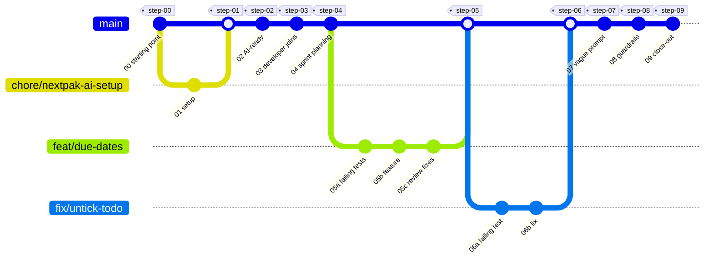
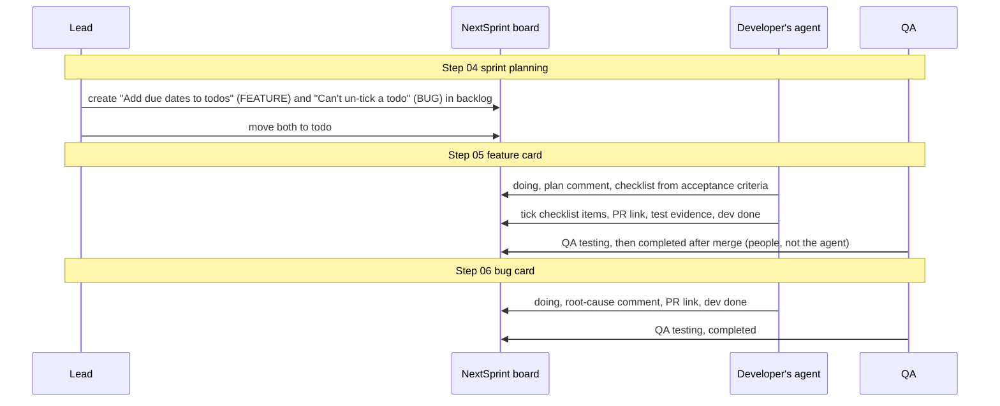

# Demo repo plan

A small todo app built commit by commit, so the team can read the history top to bottom and see
the whole AI-DLC: setup, AI-readiness, a feature card, a bug card, review, guardrails and
close-out. Each step has a short page with a picture, written so a non-technical reader can follow
it.

Status: approved 2026-10-30; dry run done 2026-10-30 (results below). Next: the real run.

## Contents

- Decisions (2026-10-30)
- The repo
- The steps
- The board
- How each step is shown
- Measuring tokens
- Dry run first
- Dry-run results (2026-10-30)
- Risks

## Decisions (2026-10-30)

| # | Question | Decision |
|---|---|---|
| 1 | Repo name | `nextpak-ai-dlc-demo`, public, on github.com/its-tahir, created after the dry run |
| 2 | Who types the agent prompts in the real run | Tahir, in Antigravity, step by step from the prompts in this plan. Claude prepares every prompt, checks every result and writes the step pages. The dry run uses Claude Code headless. |
| 3 | Board "ai readiness-workflow" | Claude creates what the demo needs: labels `BUG` and `FEATURE`, and the cards. The lists already exist. |
| 4 | Dry-run cards | Same board, titles starting with `[dry run]`. Only a board admin can delete cards, so they stay until Tahir has an admin remove them. |
| 5 | Tools for the pictures | VHS (terminal GIFs) installed on Tahir's machine; ScreenToGif for Antigravity clips. |

## The repo

- **App:** todo list. `api/`: Express 5, TypeScript, Zod, Pino, Vitest and Supertest, data kept in
  memory. `web/`: React, Vite, TypeScript, TanStack Query, Vitest and React Testing Library.
  One npm workspace at the root. This is the default stack in `node-express-standards` and
  `react-next-standards`, so the agent's code matches the team standards from the first card.
- **A real bug is in the baseline:** un-ticking a completed todo doesn't work (the API uses
  `completed || old.completed`, so `false` is ignored). No test covers it. QA "finds" it in
  step 6.
- **Layout:**

```text
README.md                 what this is, how to read it, the step table, the commit graph
walkthrough/NN-*.md       one page per step
walkthrough/assets/       GIFs and screenshots
api/  web/                the app
(+ everything the setup installs: .agents/, .claude/, .codex/, .guardrails/, .nextpak/, AGENTS.md ...)
```

- **Tags** `step-00` ... `step-09`, so anyone can open the code as it was at a step
  (`git checkout step-03`) or compare two steps on GitHub.
- **Commit messages** use the same shape every time:

```text
step 05b: feat(todos): due dates and overdue filter

Card: Add due dates to todos (NextSprint, ai readiness-workflow)
Who: developer + agent in Antigravity
Prompt: "start card Add due dates to todos"
Skills: ai-dlc, nextsprint-workflow, node-express-standards, react-next-standards, testing-qa
Page: walkthrough/05-feature-card.md
```

## The steps

| Step | Who | What happens | Commits | Board |
|---|---|---|---|---|
| 00 Starting point | Lead | A normal small project before any AI setup: the todo app with tests (and the hidden bug). | 1 | - |
| 01 One-command setup | Lead | `npx github:VIRGO96/nextpak-skills init`: stack found, 5 questions, skills, MCP, guardrails installed. PR "chore: NextPak AI setup", CI "AI guardrails" runs. | 1 + PR | - |
| 02 AI-ready | Lead + agent | "is this project AI-ready?": `docs-keeper` fills AGENTS.md (stack, commands, layout) and asks two questions: what the product is, and whether "a completed todo can't be un-ticked" is intended. The lead answers: it's a bug. | 1 | - |
| 03 A developer joins | Developer | Clone, `npm install`, `npm run ai:setup`, then "run printenv" blocked in Antigravity. Main gets branch protection. | 1 (page only) | - |
| 04 Sprint planning | Lead | Two cards created with acceptance criteria (the feature, and the bug found in step 02) and moved to todo. | 1 (page only) | 2 cards: backlog, then todo |
| 05 Feature card | Developer + agent | "start card ...": sized as Normal, plan comment and checklist on the card, failing tests first, then the code, checked in a real browser (Playwright MCP), `pr-ready`, PR. A fresh agent reviews with `review-pr`; the fixes are committed. | 3 + PR | todo, doing, dev done; QA moves it on |
| 06 Bug card | Developer + agent, then QA | The bug from step 02 (`BUG`). `systematic-debugging`: a failing test that shows the bug, the root cause (`\|\|` ignores `false`), a two-character fix, the known issue removed from the domain doc, PR. | 1-2 + PR | todo, doing, dev done, QA testing, completed |
| 07 Vague prompt | Developer + agent | "fix the bug in todos": the agent asks up to 3 questions instead of guessing. "improve my prompt: ...": `prompt-engineering` turns it into a clear prompt. | 1 (page only) | - |
| 08 Guardrails at work | Developer + agent | Asked to deploy, force-push, read `.env` or print a token: each is blocked with the reason. A commit with a fake key is stopped by the pre-commit hook. | 1 (page only) | - |
| 09 Close-out | Developer + agent | An ADR for a decision from the feature, a handoff note, and one lesson from the review added to AGENTS.md "Rules from review", so the next card starts better. | 1 | Lead moves the feature card to completed |

About 14 commits and 3 PRs. Pages marked "page only" add a walkthrough page and pictures, no app
code.



## The board

Board "ai readiness-workflow": backlog, todo, doing, dev done, QA testing, client review,
completed. Cards are created when they happen in the story, not all up front.



- The agent never moves a card past dev done (team rule in `nextsprint-workflow`).
- "client review" stays unused in the demo; the page says when a team uses it.
- Every board change is visible in the card's activity, and the step page links to it.

## How each step is shown

Every page in `walkthrough/` has the same parts, in plain language first and details after:

1. **In one sentence:** what this step achieves.
2. **Who does it:** lead, developer, QA or agent.
3. **The picture:** a Mermaid diagram (GitHub draws it, nothing to install) and, where something
   moves, a GIF:
   - terminal steps (setup, `ai:setup`, a blocked commit): VHS records them from a script, so they
     are the same every time;
   - agent steps in Antigravity: a 20-40 second ScreenToGif clip.
4. **What you type:** the exact command or prompt, ready to copy.
5. **What changed:** the files and the board, with links to the commit and the card.
6. **Tokens:** what the step cost (below).
7. **Details:** the technical part, folded (`<details>`), for developers.

The README has the step table, the commit graph above and a "start here" for non-technical
readers: read the "In one sentence" lines and watch the GIFs.

Mermaid can animate flowchart arrows (`e1@{ animate: true }`, Mermaid 11.5+). Whether GitHub
draws the animation is not documented; the dry run tests it, and the pages use plain arrows if not.

## Measuring tokens

| What | How | When |
|---|---|---|
| Always loaded (rules, skill descriptions, MCP tools) | Antigravity Settings > Projects > the project > Customizations | Steps 01, 02 and 09 (AGENTS.md grows) |
| One card, start to finish | `/context` in the Antigravity CLI (`agy`) or Claude Code at the end of the card's conversation; the IDE has no counter yet | Steps 05 and 06 |
| Per conversation | Same, for the vague-prompt and guardrails steps | Steps 07 and 08 |

The README ends with a small "What it costs" table. That gives the team real numbers for the
next topic: keeping project context small (short AGENTS.md, area docs in `docs/domains/` read only
when needed).

## Dry run first

Everything runs once in a private local folder before the public repo exists:

1. Build the baseline app; tests pass, the bug reproduces.
2. Run steps 01-09 with the real setup command and skills. Board steps use `[dry run]` cards.
3. Record which prompts needed changes, what the agent got wrong, and the token numbers.
4. Fix the skills or the setup if the dry run shows a problem (with tests), then push them.
5. Then the real run on GitHub, step by step. The `[dry run]` cards are removed later by a board admin.

## Dry-run results (2026-10-30)

Local repo `D:\dev\ai-dlc-dry-run`, Claude Code headless (Sonnet) as the agent, the real setup
command from GitHub, the real board with `[dry run]` cards. Every step ran end to end: setup, AI-ready,
a new developer's clone, both cards from backlog to completed, review, a setup update, close-out.

| Step | Turns | Time | Cost (Sonnet) |
|---|---|---|---|
| 02 AI-ready | 40 | 2.5 min | $0.64 |
| 05 Feature card (plan to PR) | 98 | 15 min | $3.54 |
| 05 Fresh-context review | 20-29 | 4 min | $0.60-0.68 |
| 06 Bug card | 58 | 6 min | $1.26 |
| 07 Vague prompt / improve my prompt | 13 / 9 | 1 min each | $0.25 / $0.19 |
| 09 Close-out | 41 | 4.5 min | $1.26 |

Always loaded in Antigravity (Settings > Customizations): team skills ~2,600 tokens, AGENTS.md
~2,100, MCP tools ~600, of a 20,000 budget each.

**What the dry run found, and the fix (all in nextpak-skills, tests pass):**

| Found | Fixed in |
|---|---|
| The readiness check wrote the un-tick bug under "Rules" (as intended behavior) and took 422, `/todos`, `{ items }` from team defaults | `docs-keeper` 0.6.0: facts from this repo's code; suspected bugs become a `TODO(question)` |
| The agent recorded "6 AC agreed" without asking (no human in a headless run) | `ai-dlc` 0.2.0: approval is the developer's reply; no reply possible = stop at the gate |
| UI change shipped without the Playwright run, Verify marked done | `ai-dlc` 0.2.0 Verify gate; `review-pr` 0.2.0 makes missing browser evidence blocking |
| A second card created for a bug that already had one, without a draft | `nextsprint-workflow` 0.3.0: `search_tasks` first, create after a yes |
| The review approved without running the tests or comparing the card's plan with the code | `review-pr` 0.2.0 |
| The bug PR left the fixed bug under "Known issues" ("after merge") | `ai-dlc` 0.2.1: docs the change makes wrong are updated in the same PR |
| `update` on Windows added a blank line to every managed block each time | setup 1.0.5: CRLF-safe blocks, LF for agent files (`.gitattributes`) |
| Pre-commit said "a AWS access key" | wording fix |

**Still open for the real run:**

- The Playwright browser check has not run in any step yet. Step 05 in Antigravity must show it
  (the agent now can't mark Verify done without it).
- Step 08's agent part was not dry-run (the guardrails were tested live before: Antigravity 6/6,
  Claude Code 3/3); Tahir types those prompts in the real run.
- The agent made small calls that belong to the developer: the overdue clock decision in the ADR,
  a test id and an empty-state text in the improved prompt. In Antigravity Tahir answers these.
- Headless runs can't show the "ask and wait" moments; the real run in Antigravity will.
- The real repo gets `.gitattributes` from step 00, so Windows line-ending warnings don't appear.
- NextSprint doesn't allow the same person as team lead and assignee: cards have an assignee and
  no team lead.
- Dry-run cards stay on the board until an admin removes them, including one the agent created
  by mistake (renamed "[dry run] DUPLICATE ...").

## Risks

| Risk | What we do |
|---|---|
| The agent's output differs between dry run and real run | Expected. The pages describe what happened in the real run, never what should have happened. |
| A bad step | Redo that branch before merging; `main` only gets reviewed PRs, the same as real work. |
| Secrets in GIFs or screenshots | Fake values only (`dummy-not-a-real-secret`); every picture is checked before commit; the pre-commit hook and CI scan run on the demo repo too. |
| Public repo shows internal process | The skills repo is already public; the demo has no client names, real data or tokens. |
