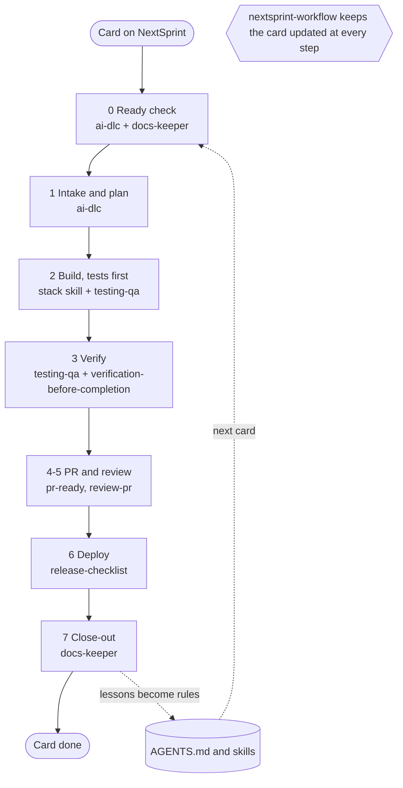
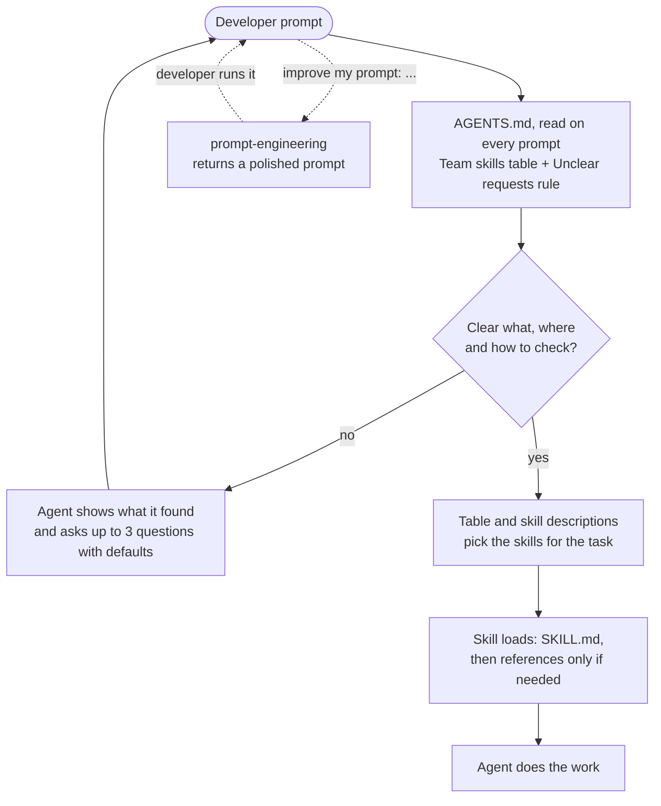
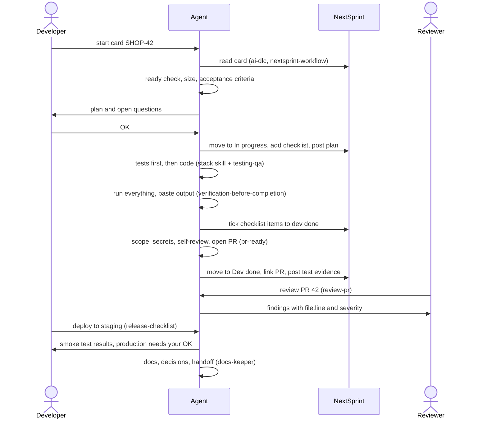
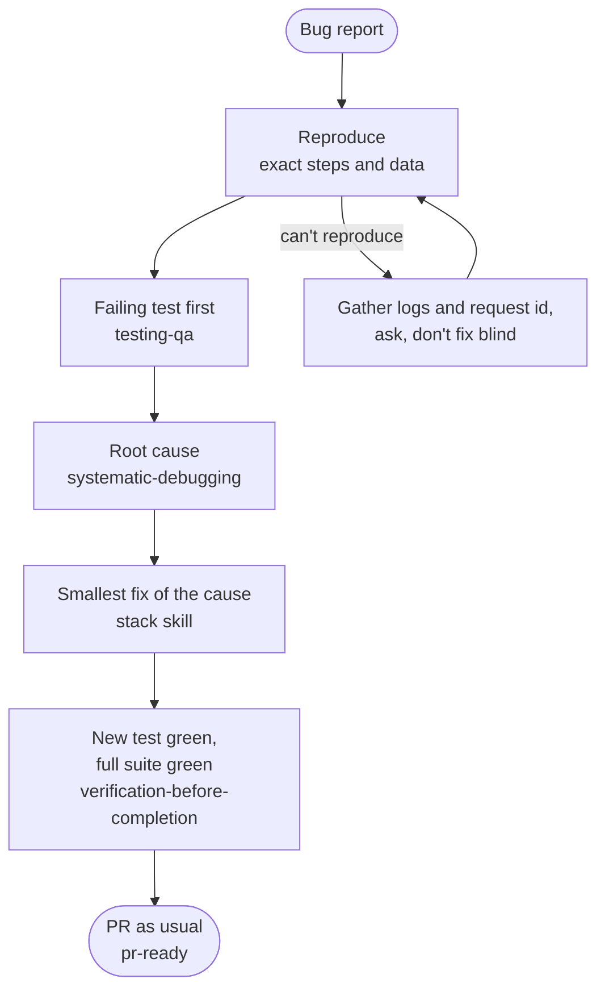
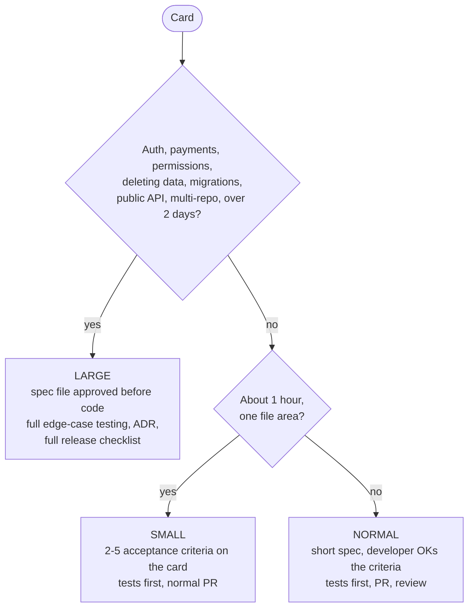
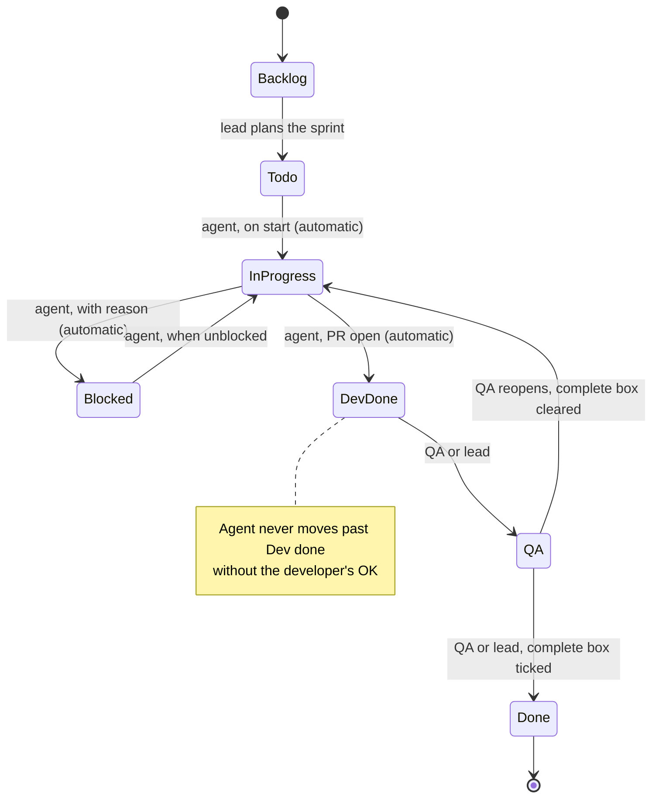
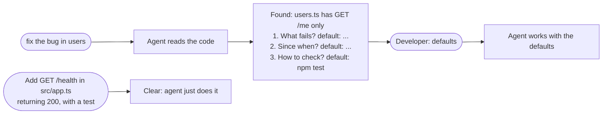

# The AI-DLC flow

How a card moves from the board to production, and which skill the agent uses at each step.
GitHub, VS Code (with a Mermaid preview extension) and Antigravity render these diagrams; the
source is plain text, so update it in the same PR when a skill's role changes.

## Contents

- 1. The big picture
- 2. How the agent picks up the right skill
- 3. One card, start to finish
- 4. The bug path
- 5. Size decides how heavy the process is
- 6. The card on the NextSprint board
- 7. Vague prompts
- 8. Cheat sheet

## 1. The big picture

Every card goes round the same loop. `ai-dlc` is the map; the other skills do the work at each
step. Close-out feeds lessons back into AGENTS.md and the skills, so the next card starts better.

## 2. How the agent picks up the right skill

Three layers. The first is always there; the others load only when needed.

## 3. One card, start to finish

What happens between the developer, the agent, the board and the reviewer on a normal feature.

## 4. The bug path

No fix without a failing test and a root cause.

## 5. Size decides how heavy the process is

Small tasks stay light; risky areas always get the full process, however few lines they touch.

## 6. The card on the NextSprint board

List names differ per board; `nextsprint-workflow` maps them by meaning. Developers' agents stop
at Dev done. Moving into Done always ticks the complete checkbox in the same call.

## 7. Vague prompts

The "Unclear requests" rule in AGENTS.md runs on every prompt in every tool.

## 8. Cheat sheet

| You want to... | Say something like | Skill that loads |
|---|---|---|
| Start or continue a card | "start card SHOP-42", "pick my next task" | `ai-dlc` + `nextsprint-workflow` |
| Update the board | "I'm blocked on the API keys, update the card" | `nextsprint-workflow` |
| Build a backend feature | "add an endpoint to cancel orders" | `node-express-standards` or `fastapi-standards` |
| Build a page or component | "build a settings page" | `react-next-standards` |
| Write tests, check edge cases | "test the edge cases before QA" | `testing-qa` |
| Fix a bug or failing test | "this returns 500, fix it" | `systematic-debugging` |
| Confirm it's really done | "is it fixed? confirm everything passes" | `verification-before-completion` |
| Open a PR | "open a PR" | `pr-ready` |
| Review a teammate's PR | "review PR 42" | `review-pr` |
| Deploy or roll back | "deploy to staging", "rollback" | `release-checklist` |
| Docs, decisions, handoff | "log this decision", "write a handoff" | `docs-keeper` |
| Write a better prompt | "improve my prompt: ..." | `prompt-engineering` |
